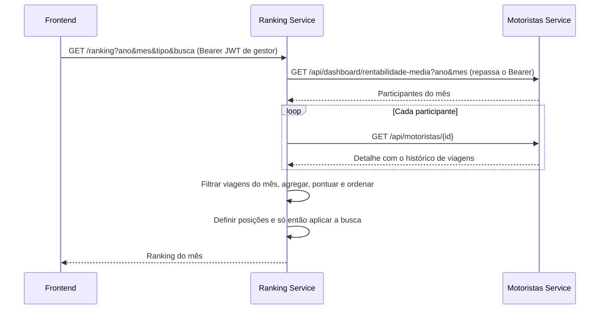

# newelog-ranking-service

> Projeto Integrador 3º Semestre · DSM · FATEC São José dos Campos · Equipe **Koitech-Log** · Cliente **NEWE Logística Integrada**
>
> [Repositório principal](https://github.com/Koitech-Log/Koitech-Log-3DSM-Newelog) · [Documentação do projeto](https://github.com/Koitech-Log/Documentos) · [auth-service](https://github.com/Koitech-Log/newelog-auth-service) · [motoristas-service](https://github.com/Koitech-Log/newelog-motoristas-service) · [manifesto-service](https://github.com/Koitech-Log/newelog-manifesto-service) · [frontend](https://github.com/Koitech-Log/newelog-frota-web)

Ranking mensal de motoristas e veículos do NEWELOG. Lê as viagens do motoristas-service, calcula a pontuação de cada participante e devolve a classificação do mês, com filtro por nome, CPF/CNPJ ou placa.

## O que este serviço entrega

| Sprint | Funcionalidade | Situação |
|---|---|---|
| 3 | Consultar os dados mensais da frota no motoristas-service (US17 · KOI-146) | ✅ |
| 3 | Endpoint de ranking por mês/ano, de motoristas ou de veículos (US17 · KOI-147) | ✅ `GET /ranking` |
| 3 | Ordenação com desempate e posições únicas (US17 · KOI-148) | ✅ |
| 3 | Filtro por mês/ano e busca por nome, CPF/CNPJ ou placa mantendo a posição real (US17 · KOI-149) | ✅ |
| 3 | Integração com o front, `totalParticipantes` e erros com mensagem em português (US17 · KOI-150) | ✅ tela Ranking no `newelog-frota-web` |
| 3 | Testes de integração do ranking (US17 · KOI-151) | ✅ |
| 3 | Limite de viagens por mês na pontuação (US18 · KOI-157) | ✅ `RANKING_MAX_VIAGENS` |
| 3 | Valorização das viagens para São Paulo (US18 · KOI-158) | ✅ `RANKING_FATOR_SP` (fator provisório) |
| 3 | Testes da valorização e do limite (US18 · KOI-159) | ✅ |
| 3 | Cálculo da pontuação e ordenação por ela (US19 · KOI-152 / KOI-153) | ✅ `criterioOrdenacao = PONTUACAO` |

**Stack:** Java 21 (Docker e CI; o código compila a partir do 17), Spring Boot 3.5.16, Spring Security (resource server JWT), RestClient, Spring Boot Actuator, Maven Wrapper. Não tem banco de dados próprio.

## Sumário

- [Como funciona](#como-funciona)
- [Rodando](#rodando)
- [Variáveis de ambiente](#variáveis-de-ambiente)
- [Autenticação](#autenticação)
- [API](#api)
- [Pontuação](#pontuação)
- [Estrutura do projeto](#estrutura-do-projeto)
- [Fluxo de branches e commits](#fluxo-de-branches-e-commits)
- [Limitações conhecidas](#limitações-conhecidas)

## Como funciona



O serviço não acessa o banco de outro serviço nem guarda dados. As viagens chegam ao motoristas-service pela importação de CSV do manifesto-service; o destino e o número do manifesto de cada viagem vêm de lá.

## Rodando

Pré-requisitos: JDK 21, o `JWT_SECRET` do `newelog-auth-service` e o motoristas-service de pé com seu banco.

```bash
git clone https://github.com/Koitech-Log/newelog-ranking-service.git
cd newelog-ranking-service
cp .env.example .env   # preencha JWT_SECRET

# Linux/macOS/Git Bash
set -a; source .env; set +a
./mvnw spring-boot:run
```

```powershell
# PowerShell
Get-Content .env | Where-Object { $_ -match '^\s*[^#].*=' } | ForEach-Object {
  $k, $v = $_ -split '=', 2; [Environment]::SetEnvironmentVariable($k.Trim(), $v.Trim())
}
.\mvnw.cmd spring-boot:run
```

O Spring **não lê o `.env` sozinho**: carregue as variáveis no terminal antes de iniciar.

O serviço sobe em `http://localhost:8083`. Para checar se está de pé: `GET http://localhost:8083/actuator/health`. O health não confirma que o motoristas-service está acessível.

### Docker

Com o motoristas-service acessível na porta 8080 do host (Docker Desktop):

```bash
docker build -t newelog-ranking-service .
docker run --rm -p 8083:8083 -e JWT_SECRET="$JWT_SECRET" \
  -e MOTORISTAS_SERVICE_URL=http://host.docker.internal:8080 newelog-ranking-service
```

No Linux com Docker Engine, acrescente `--add-host=host.docker.internal:host-gateway`. Em uma rede Docker compartilhada, use o nome do container do motoristas-service na URL. `localhost` dentro do container não aponta para o host.

### Testes

```bash
./mvnw clean verify
```

Os testes de integração sobem a aplicação com MockMvc e MockRestServiceServer, com JWT assinado e validação real: cobrem controller, segurança, cliente REST, desserialização, agregação, pontuação e ordenação, sem abrir portas nem depender de banco. Não substituem uma verificação com os serviços reais rodando; para isso há o roteiro em [`scripts/`](scripts/README.md).

O CI (GitHub Actions) roda o mesmo comando com Java 21 em pushes para `main`, `develop` e `feature-ranking` e em pull requests para `main` e `develop`.

## Variáveis de ambiente

Modelo em `.env.example`.

| Variável | Obrigatória | Padrão | Uso |
|---|---|---|---|
| `JWT_SECRET` | sim | – | Mesmo segredo do `newelog-auth-service`, mínimo 32 bytes. A aplicação não sobe sem ele |
| `PORT` | não | 8083 | Porta HTTP |
| `MOTORISTAS_SERVICE_URL` | não | `http://localhost:8080` | URL base do motoristas-service, sem `/api` |
| `FRONTEND_URL` | não | `http://localhost:5173` | Origem liberada no CORS |
| `MOTORISTAS_CONNECT_TIMEOUT_MS` | não | 5000 | Timeout de conexão por chamada ao motoristas-service |
| `MOTORISTAS_READ_TIMEOUT_MS` | não | 30000 | Timeout de leitura por chamada ao motoristas-service |
| `RANKING_MAX_VIAGENS` | não | 20 | Quantas viagens por mês contam na pontuação (mínimo 1) |
| `RANKING_FATOR_SP` | não | 1.20 | Fator da viagem para São Paulo (mínimo 1; provisório até o cliente definir) |

Valores fora da faixa impedem a aplicação de iniciar.

## Autenticação

Todas as rotas, exceto `/actuator/health` e `/actuator/info`, exigem `Authorization: Bearer <jwt>` emitido pelo `newelog-auth-service`:

- assinatura HS256 com `JWT_SECRET`;
- `iss = newelog-auth-service`;
- claim `perfil = GESTOR`. O ranking é **somente para gestor**: operador recebe `403`.

Sem token ou com token inválido/expirado, a resposta é `401`. O token do solicitante é repassado ao motoristas-service, que também o valida; o serviço não tem credenciais próprias.

## API

Erros seguem o padrão dos outros serviços: `{ "timestamp": "...", "mensagem": "..." }`, em português.

| Método | Rota | Acesso | Descrição |
|---|---|---|---|
| GET | `/ranking` (alias `/api/ranking`) | gestor | Ranking do mês |
| GET | `/actuator/health`, `/actuator/info` | público | Saúde e informações do serviço |

### Parâmetros

| Parâmetro | Obrigatório | Valores |
|---|---|---|
| `ano` | sim | 1 a 9999 |
| `mes` | sim | 1 a 12 |
| `tipo` | não | `motoristas` (padrão) ou `veiculos` |
| `busca` | não | Nome, CPF/CNPJ (com ou sem pontuação) ou placa |

### Exemplo

```bash
curl "http://localhost:8083/ranking?ano=2026&mes=4&tipo=motoristas" \
  -H "Authorization: Bearer $TOKEN"
```

Resposta ilustrativa:

```json
{
  "ano": 2026,
  "mes": 4,
  "tipo": "motoristas",
  "criterioOrdenacao": "PONTUACAO",
  "totalParticipantes": 123,
  "dados": [
    {
      "posicao": 1,
      "motoristaId": 42,
      "motorista": "Fulano de Tal",
      "veiculo": "ABC1D23",
      "quantidadeViagens": 18,
      "freteTotal": 52300.00,
      "custoTotal": 1840.50,
      "resultado": 50459.50,
      "distanciaKm": null,
      "destinos": ["São Paulo", "Campinas"],
      "pontuacao": 55120.30
    }
  ]
}
```

### Regras

- `totalParticipantes`: participantes do mês/tipo **antes** da busca (0 em mês sem viagens).
- `resultado` = soma dos fretes − soma dos pedágios, com todas as viagens do mês. Não muda com a pontuação.
- Ordem: `pontuacao` decrescente, depois viagens decrescentes, nome/placa (sem diferenciar acento nem maiúscula) e ID. Empate não divide posição: as posições são únicas, de 1 a N.
- A posição é definida **antes** da busca e não muda quando se filtra.
- Na visão de veículos, `motoristaId` e `motorista` são nulos e `veiculo` identifica a placa.
- Participantes sem viagens no mês não entram; viagens sem placa não geram veículo fictício.
- Mês sem viagens e busca sem resultado retornam `dados: []` com HTTP 200.

### Códigos de resposta

| Código | Situação |
|---|---|
| 400 | Parâmetro ausente ou inválido |
| 401 | Sem token, token inválido ou expirado |
| 403 | Usuário autenticado sem perfil de gestor |
| 502 | Erro ou resposta inválida do motoristas-service |
| 503 | Falha de conexão ou timeout com o motoristas-service |

Uma falha em qualquer chamada ao motoristas-service interrompe a resposta inteira; não é devolvido ranking parcial.

## Pontuação

Calculada por participante (motorista ou placa) com as viagens do mês:

1. **Valor da viagem** = frete − pedágio.
2. **Valorização SP** (KOI-158): o destino pode ser uma cidade ou uma lista separada por vírgula. Se **qualquer** cidade da lista for exatamente "São Paulo" (sem diferenciar acento, maiúscula nem espaços), o valor é multiplicado por `RANKING_FATOR_SP` uma única vez e arredondado a 2 casas.
   - Recebem o fator: "São Paulo", "São Paulo, Cotia", "Guarulhos, São Paulo, Diadema".
   - Não recebem: "Paulo Afonso", "São Paulo do Potengi", "São Paulo das Missões", "Não informado".
   - Destino resumido pelo manifesto-service (termina em "…"): a última cidade pode estar cortada e não conta; as anteriores contam.
3. **Limite de viagens** (KOI-157): só contam as `RANKING_MAX_VIAGENS` viagens de maior valor já valorizado; as demais ficam fora da pontuação.
4. **`pontuacao`** = soma dos valores que contam (0.00 sem viagens).

A pontuação não altera `freteTotal`, `custoTotal`, `resultado` nem `quantidadeViagens`, que continuam com todas as viagens do mês.

## Estrutura do projeto

```
src/main/java/br/com/newelog/
├── RankingServiceApplication.java
└── ranking/
    ├── client/        MotoristasClient (chamadas ao motoristas-service)
    ├── config/        SecurityConfig (JWT, CORS), MotoristasConfig, Valorizacao*, LimitacaoViagens*
    ├── controller/    RankingController, ApiExceptionHandler
    ├── dto/           RankingResponse
    └── service/       RankingService, PontuacaoRankingService, ValorizacaoViagemService, LimitacaoViagensService
src/main/resources/application.properties
src/test/          Integração (RankingIntegrationTest) e testes unitários da pontuação
scripts/           Roteiro de teste integrado local com os quatro serviços (Test-Stack.ps1)
```

## Fluxo de branches e commits

Segue o [modelo de branches do projeto](https://github.com/Koitech-Log/Koitech-Log-3DSM-Newelog/blob/main/docs/MODELO-DE-BRANCHES.md): `main` ← `develop` ← branches de feature/fix, com PR para `develop`.

Commits seguem o card do Jira:

```
US17-KOI147 feat: disponibilizar endpoint de ranking
US18-KOI158 fix: aplicar o fator SP quando São Paulo estiver na lista de cidades do destino
```

## Limitações conhecidas

- São 1 + N chamadas HTTP para N participantes, sem cache. Os timeouts valem por chamada, então meses com muitos participantes demoram mais.
- Não há snapshot transacional: mudanças na base do motoristas-service durante as chamadas podem aparecer parcialmente.
- A base não tem quilometragem: `distanciaKm` é sempre `null`, nunca um zero inventado.
- Os destinos são os gravados na viagem; quando o CSV não traz destino, a fonte grava "Não informado".
- A placa vem do cadastro **atual** do motorista; não há histórico de veículo por viagem.
- `RANKING_FATOR_SP` = 1.20 é provisório até o cliente definir o valor.
- O serviço só lê dados: não altera viagens nem as regras de importação e deduplicação, que ficam no motoristas-service.
